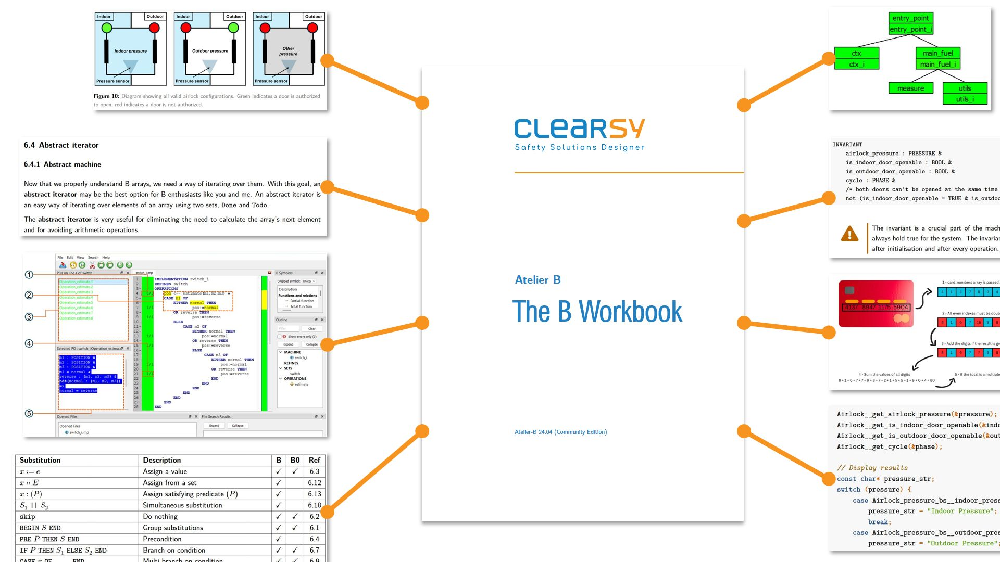
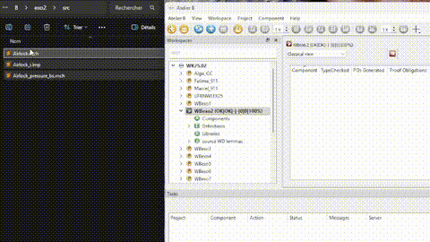

# B WORKBOOK

The B WORKBOOK is available on CLEARSY's GitHub, to be consulted and used for training in the use of formal methods and teaching the B method.
The first version (122 pages, September 2025) introduced system modeling with Atelier B. This second version (259 pages, November 2026) adds a chapter on interactive proof, proof tactics and writing proof rules.

Many thanks to the contributors and reviewers, from Europe and South America, who have made this possible.

## CONTENTS

The B WORKBOOK now contains 14 exercises of increasing complexity, in two chapters, providing a step-by-step introduction to the various Atelier B functionalities.
It covers the phases of formal specification, implementation, proof, code generation, and compilation of the final executable.
Each exercise is supplied with:
- modeling files,
- proof files that automatically demonstrate these models,
- additional manual source code and associated Makefile, for compilation in Unix environments (Windows WSL, Linux, MacOS).
It also contains instructions for using ProB to animate models.

The first chapter, *System Modeling*, contains 7 exercises:
- a simple railroad switch,
- an airlock operating system,
- an integer arithmetic calculator,
- a fuel level supervisor,
- a simple loop usage example,
- filling an array with a given value,
- find the maximum of an array.

The second chapter, *Interactive proof, proof tactics and writing proof rules*, contains 7 exercises:
- junction interlocking, an introduction to interactive proof,
- summations and existential quantification,
- the Luhn algorithm,
- XOR integrity over an untrusted link,
- automatic block signaling,
- sensors,
- proving the Luhn algorithm.

Every proof obligation of the 14 exercises is proved with Atelier B 24.04.2 Community Edition, without any project setting and without an external prover, by following the procedure of each exercise: the automatic prover at the force it gives, then the *User Pass* with the *pmm* files supplied.

## INSTALLING MODELS

Each exercise has its own directory in *src*.
Create one project per example.
Before creating a project with Atelier B:
- create a directory for the project in a place where you have read/write access;
- create subdirectories *bdp*, *lang*, and *src*;
- when you create the project with Atelier B, on the second window:
	- For the *Project Database* field: select the *bdp* subdirectory just created.
	- For the *Translations directory*: you don't need to select the *lang* directory as Atelier B already noticed its existence;
- move the source files (mch, ref, imp, pmm files) from the github to the *src* subdirectory;
- open the project, select the classical view,
- open a file explorer on the *src* subdirectory, select all the files, drag & drop the files on the Atelier B project panel: they have been added to your project.

- if a file is missing, it should appear on the Atelier B panel with a red cross. Just add the missing file to remove the error.

For the proof:
- keep each *pmm* file in the same directory as the source of its component: it holds the proofs of the component (its *User_Pass* theory) and, for some exercises, user rules;
- run the automatic prover, then the *User Pass*: every proof obligation is then proved.

For the code generation phase:
- the target directory is *lang/c* - use the menu item "Open folder" to launch a file explorer once the project is open;
- follow the indications from the B Workbook:
	- Some files (c, h) are generated from the B models.
	- Some others are developed manually - just copy them in the *lang/c* directory.
	- In any case, copy the Makefile in this *lang/c* directory.

## WHAT'S NEXT ?

In a future iteration in 2027, new exercises will be added, covering in particular:
- Event-B modeling,
- Graphical animation of models with VisB,
- Rust code generation.

In the meantime, if you find errors or have ideas for exercises or technical topics to address, please interact through the mechanisms offered by GitHub (issues, PR).

Shield: [![CC BY-NC-SA 4.0][cc-by-nc-sa-shield]][cc-by-nc-sa]

This work is licensed under a
[Creative Commons Attribution-NonCommercial-ShareAlike 4.0 International License][cc-by-nc-sa].

[![CC BY-NC-SA 4.0][cc-by-nc-sa-image]][cc-by-nc-sa]

[cc-by-nc-sa]: http://creativecommons.org/licenses/by-nc-sa/4.0/
[cc-by-nc-sa-image]: https://i.creativecommons.org/l/by-nc-sa/4.0/88x31.png
[cc-by-nc-sa-shield]: https://img.shields.io/badge/License-CC%20BY--NC--SA%204.0-lightgrey.svg
